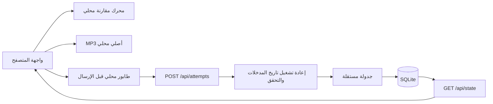

# المعمارية

## القرار الأساسي

تطبيق Next.js 16.4.5 App Router وReact 19.3.1 وTypeScript، يعمل بعملية Node.js 24 وSQLite محلية. لا توجد خدمة سحابية لازمة للتجربة. قصص JSON ثابتة وصوت MP3 مولّد مسبقًا. هذا اختيار مستقل، وليس استنتاجًا عن البنية الداخلية للموقع المفحوص.

## توزيع الكود

- `content/stories.json`: ثلاث قصص، 18 سطرًا، ترجمات وكلمات؛ `lib/catalog.ts` يضيف معرّفات ومسارات آمنة محددة سلفًا.
- `lib/engine.ts`: آلة حالات نقية. يستخدمها المتصفح والخادم واختبارات الوحدة.
- `components/typing-round.tsx`: إدخال، ألوان مرجع النص، مؤشرات الخطأ والكلمة الأساسية.
- `components/audio-player.tsx`: ملف سطر، سرعة مع حفظ طبقة الصوت، مسار نطق الجهاز عند فشل الملف.
- `components/study.tsx`: بدء/استكمال القصة، تقدم السطر، حفظ وملخص النهاية.
- `lib/client-store.ts`: journal محلي قبل الشبكة، حد 200 نتيجة، إعادة إرسال بذات المعرّف.
- `app/api/state` و`app/api/attempts`: تهيئة جلسة وقراءة تقدم والتحقق من النتائج.
- `lib/db.ts`: تخزين SQLite ومعاملة للحفظ؛ `lib/scheduler.ts`: مواعيد مستقلة.
- `components/review.tsx`: قائمة المواعيد وجلسة حتى خمس جمل، وتدريب مبكر صريح.
- `components/words.tsx`: كلمات الأسطر المكتملة وأمثلتها الأصلية.

## البيانات

جدول `progress`: مفتاح مركب `(owner,line_id)`، وJSON يحوي الدقة والعدادات والموعد والتكرارات. جدول `attempts`: مفتاح `(owner,id)` لتجنب مضاعفة الحفظ إذا أعيد الطلب. `owner` هو SHA-256 لرمز Cookie عشوائي 256-bit؛ لا يُقبل owner من جسم الطلب. الاستعلامات كلها معاملية، وWAL مع busy timeout 5 ثوانٍ.

الحفظ داخل `BEGIN IMMEDIATE`: يفحص تكرار معرّف المحاولة، يعيد تشغيل تاريخ الكتابة، يحسب الجدول، ثم يضيف المحاولة ويحدّث السطر ويؤكد العملية. تكرار نفس المحاولة يعيد الحالة الحالية دون زيادة عدد المحاولات أو مدة المراجعة.

## دورة المستخدم

1. `GET /api/state` ينشئ Cookie إذا لزم، ويرجع حالة هذه الجلسة فقط دون كاش مشترك.
2. اختيار قصة يبدأ أول سطر غير مكتمل، أو أول القصة عند اكتمالها سابقًا.
3. كل تغيير إدخال يمر بالمحرك؛ الصوت مستقل عن نتيجة الشبكة.
4. عند اكتمال السطر تُكتب المحاولة في localStorage، ثم ترسل للخادم.
5. الخادم يتحقق ويحسب النتائج والموعد؛ عند النجاح يُحذف السجل المعلّق، ويظهر السطر التالي بعد 600ms.
6. إذا انقطعت الشبكة يبقى السجل للمزامنة، وتستمر الكتابة. عند عودة الاتصال أو زر المزامنة تُعاد المحاولة.
7. المراجعة تعرض السجلات المستحقة؛ إكمال سطر مراجعة يعيد حساب الفترة على الخادم.

## حدود نشر مهمة

قاعدة SQLite على قرص دائم وبعملية نشر واحدة. التطبيق لا يناسب مباشرة استضافة serverless بقرص مؤقت أو عدة نسخ غير مشتركة. يمكن نقله لاحقًا إلى قاعدة مركزية دون تغيير المحرك. لا توجد حسابات أو فواتير أو مواد مدفوعة؛ كل القصص المضمّنة مفتوحة عمدًا. عرض المصدر والقصص الأصلية للمتصفح ليس آلية دفع.
